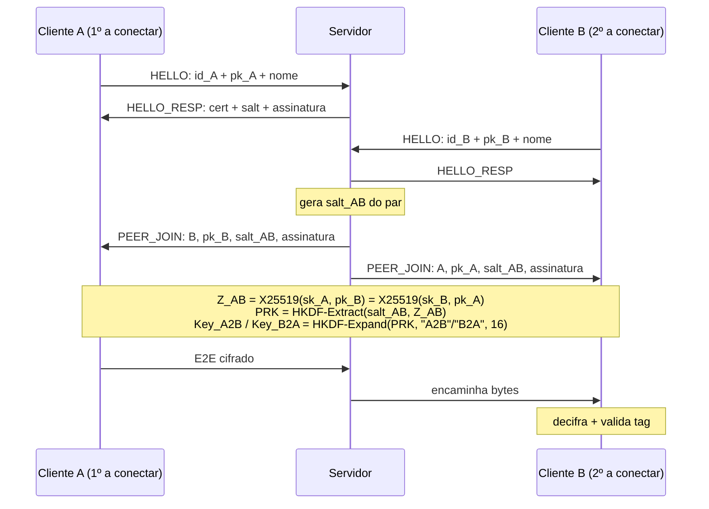

<div align="center">

# 🔐 Sistema de Mensageria Segura Multi-Cliente

Chat multi-cliente com **criptografia ponta-a-ponta (E2E)** em Python. O servidor funciona só como *relay*: ele autentica o handshake e distribui as chaves públicas; **um servidor honesto não consegue decifrar** as mensagens trocadas entre os clientes.

[](https://github.com/guilherme-luna/Sistema-de-Mensageria-Segura-Multi-Cliente/actions/workflows/ci.yml)


</div>

> Trabalho Prático 2 da disciplina de Segurança - UFC (Prof.Michel Sales).

<details>
<summary><b>📑 Sumário</b></summary>

- [Garantias de segurança](#-garantias-de-segurança)
- [Como funciona](#-como-funciona)
  - [Formato dos frames](#formato-dos-frames)
  - [Decisões de protocolo](#decisões-de-protocolo)
- [Estrutura do projeto](#-estrutura-do-projeto)
- [Requisitos](#-requisitos)
- [Configuração](#-configuração)
- [Uso](#-uso)
  - [Demonstração de ataques (proxy MITM)](#demonstração-de-ataques-proxy-mitm)
  - [Em máquinas diferentes (mesma rede)](#em-máquinas-diferentes-mesma-rede)
  - [Com Docker](#com-docker)
- [Testes](#-testes)
- [Parâmetros](#-parâmetros)
- [Política de logs](#-política-de-logs)

</details>

---

## 🔒 Garantias de segurança

| Propriedade | Mecanismo |
|---|---|
| 🔒 Confidencialidade | AES-128-GCM (AEAD) |
| ✅ Integridade | Tag de autenticação do GCM (16 bytes) |
| 🪪 Autenticidade do servidor | Certificado RSA autoassinado e pinado + assinatura RSA-PSS/SHA-256 |
| ⏳ Sigilo perfeito (*forward secrecy*) | Chaves efêmeras X25519 (ECDHE) |
| 🔁 Anti-replay | `seq_no` monotônico por direção |
| 🙈 Servidor cego | Chaves E2E derivadas apenas nos clientes (HKDF-SHA256) |

---

## 🧭 Como funciona



<details>
<summary>Versão em texto do diagrama</summary>

```
Cliente A (1º a conectar)         Servidor                  Cliente B (2º a conectar)
    | HELLO: id_A + pk_A + nome -->  |                              |
    | <-- HELLO_RESP: cert + salt + assinatura                      |
    |                                |  <-- HELLO: id_B + pk_B + nome
    |                                |  HELLO_RESP -->              |
    |                                |  gera salt_AB do par         |
    | <-- PEER_JOIN: B, pk_B, salt_AB, assinatura                   |
    |                                |  PEER_JOIN: A, pk_A, salt_AB, assinatura -->
    |                                                               |
    |   Z_AB = X25519(sk_A, pk_B)        Z_AB = X25519(sk_B, pk_A)  |
    |   PRK  = HKDF-Extract(salt_AB, Z_AB)                          |
    |   Key_A2B / Key_B2A = HKDF-Expand(PRK, "A2B"/"B2A", 16)       |
    |                                                               |
    | -- E2E cifrado -->             | -- encaminha bytes -->       |
    |                                |            decifra + valida tag
```

</details>

1. **Handshake:** o cliente gera um par X25519 efêmero e envia `HELLO` com `client_id` (UUID v4, 16 B), `pk_client` (32 B raw) e seu nome.
2. **Autenticação do servidor:** o servidor responde `HELLO_RESP` com seu certificado, um `salt` de 16 B e a assinatura RSA-PSS de `SHA256(pk_S || pk_client || client_id || salt)`, onde `pk_S` é a chave pública RSA do servidor em DER. O cliente verifica a assinatura com o certificado pinado (`certs/public/server.crt`).
3. **Rendezvous:** para cada par de clientes, o servidor gera um `salt_AB` aleatório e envia aos dois um `PEER_JOIN` com o `client_id`, a chave pública e o nome do outro, o `salt_AB` e um contador `seq_send`, tudo assinado com RSA-PSS. Um MITM não consegue trocar a chave de um peer sem invalidar a assinatura.
4. **Derivação:** cada par calcula o segredo ECDH e deriva uma chave AES por direção via HKDF com o `salt_AB` do par.
5. **Mensagens:** cada mensagem é cifrada com AES-128-GCM e o servidor só a encaminha.

**Confiança no servidor:** a assinatura de `PEER_JOIN` confirma que o anúncio
foi emitido pelo servidor autenticado. Ela não prova que esse servidor é honesto.
Um servidor malicioso, com sua chave RSA legítima, poderia anunciar chaves
X25519 falsas aos participantes e intermediar as mensagens, comprometendo
a confidencialidade. O projeto pressupõe um servidor honesto na distribuição
das chaves públicas. O certificado pinado protege contra a substituição do
servidor por terceiros; não elimina essa confiança no próprio servidor.

### Formato dos frames

Todo frame em TCP começa com o tamanho (4 bytes, big-endian, contando tipo + corpo) e um byte de tipo:

```
| tamanho (4B) | tipo (1B) | corpo |
```

| Tipo | Valor | Direção | Corpo |
|---|:---:|---|---|
| `HELLO` | `0x01` | cliente → servidor | client_id (16) + pk_client (32) + nome (1–32, ASCII) |
| `HELLO_RESP` | `0x02` | servidor → cliente | tamanho do certificado (2) + certificado DER + salt (16) + assinatura |
| `PEER_JOIN` | `0x03` | servidor → cliente | client_id (16) + pk (32) + salt_AB (16) + seq_send (8) + papel (1) + tamanho do nome (1) + nome + assinatura |
| `PEER_LEAVE` | `0x04` | servidor → cliente | client_id do peer (16) + seq_send (8) + assinatura |
| `E2E` | `0x10` | cliente → cliente (relay) | frame E2E abaixo |
| `ERROR` | `0x7F` | servidor → cliente | código de erro (1 B) |

> [!IMPORTANT]
> Tipo desconhecido ou tamanho inválido é tratado como erro de framing: a conexão é encerrada.

O corpo de um frame `E2E` é exatamente o frame do enunciado:

```
| nonce (12B) | sender_id (16B) | recipient_id (16B) | seq_no (8B) | ciphertext || tag (16B) |

nonce = IV_base (4B) || seq_no (8B, big-endian)
AAD   = sender_id || recipient_id || seq_no
```

O destinatário rejeita o frame se a tag GCM não confere (adulteração) ou se `seq_no <= último seq_no aceito` (replay).

### Decisões de protocolo

| # | Ponto | Decisão |
|:---:|---|---|
| 1 | Salt da derivação E2E | Um `salt_AB` por **par** de clientes, gerado pelo servidor e enviado igual aos dois |
| 2 | Autenticidade das chaves dos peers | `PEER_JOIN` e `PEER_LEAVE` assinados com RSA-PSS e com `seq_send` |
| 3 | Quem é A e quem é B | Em cada par, **A é quem conectou primeiro**. Quem recebe um `PEER_JOIN` de alguém que já estava conectado é B; quem é avisado da chegada de alguém novo é A |
| 4 | `pk_S` no hash assinado | Chave pública RSA do servidor em DER (SubjectPublicKeyInfo) |
| 5 | IV_base do outro lado | O receptor lê o nonce do frame e confere que `nonce[4:] == seq_no` |
| 6 | Tipo de mensagem | 1 byte de tipo após o prefixo de tamanho |
| 7 | Certificado | Cada integrante gera o seu; nada em `certs/` é versionado. Na apresentação, servidor e clientes rodam no mesmo notebook |
| 8 | Nome do cliente | Enviado no `HELLO` e repassado no `PEER_JOIN` assinado. De 1 a 32 caracteres `[A-Za-z0-9_-]`; o servidor recusa nomes repetidos |
| 9 | `client_id` | UUID v4 novo a cada execução; `--id <uuid>` reutiliza um id (teste de reconexão) |
| 10 | Material assinado de `PEER_JOIN`/`PEER_LEAVE` | `tipo ‖ recipient_id ‖ salt do HELLO_RESP ‖ campos`: a assinatura não serve para outro tipo de mensagem, outro destinatário nem outra conexão |
| 11 | Papel no par | O `PEER_JOIN` leva um byte assinado dizendo se o destinatário é A ou B, aplicando a decisão 3 sem depender da ordem de chegada |
| 12 | `client_id` repetido | Se o id já está conectado, o servidor recusa o novo `HELLO` (`ID_TAKEN`) em vez de derrubar a sessão existente |
| 13 | Antes do handshake | Só um `HELLO` é aceito, com tamanho máximo de um `HELLO` e prazo de `HANDSHAKE_TIMEOUT` segundos |

---

## 📁 Estrutura do projeto

```
.
├── common/
│   ├── framing.py      # leitura/escrita de frames com prefixo de tamanho
│   ├── protocol.py     # constantes, tipos de mensagem e frame E2E
│   ├── messages.py     # HELLO, HELLO_RESP, PEER_JOIN, PEER_LEAVE e o material assinado
│   ├── crypto.py       # X25519, HKDF, AES-GCM, RSA-PSS, certificado pinado
│   ├── config.py       # configuração por variáveis de ambiente / .env
│   └── log.py          # logging e fingerprint() de chaves públicas
├── server/
│   └── server.py       # relay asyncio + tabela de sessões
├── client/
│   └── client.py       # cliente CLI + tabela de peers
├── scripts/
│   └── gen_cert.py     # gera chave RSA e certificado autoassinado
├── tools/
│   └── mitm_proxy.py   # proxy MITM da demo: bitflip, replay e troca de chave
├── docs/
│   └── apresentacao.md # roteiro da apresentação e da demo
├── tests/              # testes automatizados (pytest)
└── certs/              # gerado localmente, nada aqui é versionado
    ├── server.key      #   chave privada (só na máquina do servidor)
    └── public/
        └── server.crt  #   certificado pinado (copiado para os clientes)
```

---

## 📦 Requisitos

- Python 3.10+ (o CI testa em 3.10 e 3.13)
- [`cryptography`](https://cryptography.io/) e [`python-dotenv`](https://github.com/theskumar/python-dotenv), em versões fixas no `requirements.txt` para que todas as máquinas instalem exatamente o mesmo

```bash
python -m venv .venv
source .venv/bin/activate        # Windows: .venv\Scripts\activate
pip install -r requirements-dev.txt
```

---

## 🔧 Configuração

As configurações vêm de variáveis de ambiente. Para usar um arquivo local, copie o exemplo (o `.env` não é versionado):

```bash
cp .env.example .env
```

| Variável | Padrão | Usada por | Descrição |
|---|---|---|---|
| `SERVER_BIND_HOST` | `127.0.0.1` | servidor | interface de escuta (`0.0.0.0` aceita outras máquinas) |
| `SERVER_HOST` | `127.0.0.1` | cliente | endereço do servidor |
| `SERVER_PORT` | `9000` | servidor / cliente | porta TCP |
| `MAX_CLIENTS` | `64` | servidor | conexões simultâneas aceitas |
| `HANDSHAKE_TIMEOUT` | `10` | servidor / cliente | prazo do handshake em segundos (1 a 300) |
| `SERVER_KEY_PATH` | `certs/server.key` | servidor | chave privada RSA |
| `SERVER_CERT_PATH` | `certs/public/server.crt` | servidor | certificado autoassinado |
| `PINNED_CERT_PATH` | `certs/public/server.crt` | cliente | certificado pinado do servidor |
| `LOG_LEVEL` | `INFO` | ambos | `DEBUG`, `INFO`, `WARNING` ou `ERROR` |

> [!NOTE]
> Os argumentos `--host` e `--port` têm prioridade sobre as variáveis. Variáveis vazias usam o padrão, e caminhos relativos partem da raiz do projeto. Os comandos `python -m ...` devem ser rodados na raiz do projeto. As constantes do protocolo (tamanhos de salt, nonce, tag e plaintext máximo) ficam em `common/protocol.py` e não são configuráveis, porque cliente e servidor precisam concordar nelas.

---

## 🚀 Uso

**1. Gerar o certificado do servidor** (uma vez):

```bash
python scripts/gen_cert.py
```

Isso cria `certs/server.key` (privada, ignorada pelo git) e `certs/public/server.crt` (pública, pinada nos clientes).

O certificado não é de autoridade certificadora (CA) e só serve para assinatura digital: o cliente o usa apenas para verificar a assinatura do handshake e dos anúncios de peers.

> [!NOTE]
> No Linux e no macOS, a chave privada é criada com permissão `600` (só o dono lê). No **Windows** essa permissão não tem efeito: a proteção vem da pasta do usuário (`C:\Users\<nome>\...`), que outros usuários comuns da máquina não acessam, então mantenha o projeto dentro dela. Em qualquer sistema, a chave nunca entra no git (`.gitignore`) nem na imagem Docker, e não deve ser copiada para as máquinas dos clientes.

**2. Subir o servidor:**

```bash
python -m server.server
```

**3. Conectar clientes** (um terminal para cada):

```bash
python -m client.client --name alice
python -m client.client --name bob
```

O nome aceita de 1 a 32 caracteres entre letras, números, `_` e `-`. A cada execução o cliente gera um `client_id` novo, mostrado no log; para reconectar com o mesmo id, use `--id <uuid>`.

**4. Comandos no cliente:**

| Comando | Ação |
|---|---|
| `/peers` | lista os clientes conectados |
| `/msg <nome> <texto>` | envia uma mensagem E2E |
| `/quit` | desconecta |

Uma mensagem recebida aparece só na tela, como `[alice] Olá, Bob!`, nunca no log. O cliente continua recebendo enquanto espera o teclado. Comando desconhecido ou incompleto mostra a ajuda; destinatário ausente ou mensagem acima de 4096 bytes mostra um aviso e o cliente continua. `/quit`, fim da entrada (Ctrl+Z e Enter no Windows, Ctrl+D no Linux) ou queda do servidor encerram a sessão sem precisar de Enter.

**Proteções do servidor contra clientes problemáticos:**

- **Prazo do handshake:** `HANDSHAKE_TIMEOUT` (padrão 10 s) limita a espera do servidor pelo `HELLO` e do cliente pelo `HELLO_RESP`.
- **Fila por destinatário:** cada cliente tem no máximo 1 MiB esperando envio no servidor. Um cliente que para de ler é desconectado sozinho (`PEER_LEAVE` para os outros), sem atrasar a conversa dos demais.

### Demonstração de ataques (proxy MITM)

O `tools/mitm_proxy.py` fica entre **um** cliente e o servidor, como um atacante na rede. Ele mostra cada frame E2E que passa (quem fala com quem, `seq_no` e o começo do ciphertext em hex, nunca o texto) e ataca sob comando.

Um terminal para cada:

```bash
python -m server.server
python -m tools.mitm_proxy --listen 9001 --upstream 127.0.0.1:9000
python -m client.client --name alice --port 9001   # alice passa pelo proxy
python -m client.client --name bob                 # bob conecta direto
```

| Comando no proxy | Ataque | O que o destinatário mostra |
|:---:|---|---|
| `b` | inverte 1 bit na próxima mensagem da alice | `frame E2E rejeitado: ... tag GCM inválida (frame adulterado)` |
| `r` | reenvia a última mensagem da alice, byte a byte igual | `frame E2E rejeitado: ... seq_no N já visto (replay)` |
| `k` | troca a chave pública do próximo `PEER_JOIN` que a alice recebe (conecte um terceiro cliente para gerar um) | alice: `mensagem do servidor NÃO autenticada, conexão abortada: assinatura RSA-PSS inválida` |

Depois de `b` e `r`, a conversa continua normalmente: o ataque só descarta o frame atacado. O `k` derruba a alice, então deixe-o por último.

### Em máquinas diferentes (mesma rede)

Todas as máquinas precisam estar na mesma rede (mesmo Wi-Fi ou hotspot).

**1. Na máquina do servidor**

```bash
python scripts/gen_cert.py
```

No `.env`:

```
SERVER_BIND_HOST=0.0.0.0
```

```bash
python -m server.server
```

Na primeira execução, o Windows pergunta sobre o Firewall: permita o acesso marcando **rede privada**. Anote o IP da máquina (`ipconfig` no Windows, `ip addr` no Linux, campo "Endereço IPv4"), por exemplo `192.168.0.16`.

**2. Em cada máquina de cliente**

Copie **apenas** o `certs/public/server.crt` da máquina do servidor para `certs/public/server.crt` do projeto (pen drive, Discord, etc.). Cada integrante gerar o próprio certificado não funciona: o cliente só confia no certificado do servidor em que vai conectar.

> [!WARNING]
> O `server.key` nunca sai da máquina do servidor.

No `.env`:

```
SERVER_HOST=192.168.0.16   # IP anotado no passo 1
```

```bash
python -m client.client --name bob
```

**3. Resultado esperado**

O servidor mostra `conexão de ('<IP do cliente>', ...)` e o cliente mostra `bob conectado a 192.168.0.16:9000`.

<details>
<summary><b>🩺 Se não conectar</b></summary>

| Sintoma | Causa provável | Solução |
|---|---|---|
| Cliente demora e dá timeout | Firewall da máquina do servidor bloqueando a porta | Permita o Python no Firewall do Windows para redes privadas, ou libere a porta do `SERVER_PORT` |
| Timeout mesmo com o firewall liberado | A rede (ex.: Wi-Fi da faculdade) bloqueia comunicação entre aparelhos | Use um hotspot de celular |
| `Connection refused` | Servidor não está rodando ou está com `SERVER_BIND_HOST=127.0.0.1` | Confira o `.env` do servidor e reinicie |
| `certificado pinado não encontrado` | `server.crt` não foi copiado para o cliente | Copie para `certs/public/server.crt` ou ajuste `PINNED_CERT_PATH` |

</details>

### Com Docker

Gere o certificado antes (passo 1). Ele entra por volume, nunca na imagem. As variáveis do `.env` são lidas pelo Compose; os caminhos dos certificados são fixos dentro do container.

```bash
docker compose up --build server                # servidor na porta do .env (padrão 9000)
docker compose run --rm client --name alice     # cliente, em outro terminal
```

---

## 🧪 Testes

Na raiz do projeto, com as dependências de desenvolvimento instaladas:

```bash
python -m ruff check .
python -m pytest -q
```

| Cobertura | Arquivo principal | O que é verificado |
|---|---|---|
| Troca de mensagens E2E | `tests/test_e2e.py` | Dois ou mais clientes, ambas as direções, texto e limites de envio |
| Adulteração e replay | `tests/test_e2e.py` | Falha de autenticação, contador repetido e continuidade após descarte |
| Reconexão completa | `tests/test_scenarios.py` | Mesmo UUID e nome, nova chave efêmera, novas chaves por direção, contadores reiniciados e mensagens nas duas direções |
| Mensagem da sessão anterior | `tests/test_scenarios.py` | Ciphertext antigo é rejeitado após reconexão sem impedir mensagens novas |
| Framing inválido após autenticação | `tests/test_scenarios.py` | Tamanho zero, acima do limite, tamanho forjado, tipo desconhecido, prefixo incompleto e corpo incompleto |
| Isolamento do erro de framing | `tests/test_scenarios.py` | `BAD_FRAME`, encerramento só do infrator, `PEER_LEAVE` e outros dois clientes continuam conversando |
| Handshake e distribuição de chaves | `tests/test_handshake.py`, `tests/test_rendezvous.py` | Certificado pinado, assinaturas, papéis e anúncios de participantes |
| CLI e configuração | `tests/test_cli.py`, `tests/test_config.py` | Comandos, encerramento, variáveis e timeout |
| Destinatário sem leitura | `tests/test_server_buffers.py` | Limite de 1 MiB e continuidade dos clientes restantes |
| Ferramenta da demonstração | `tests/test_mitm_proxy.py` | Bitflip, replay e troca de chave feitos pelo próprio proxy da apresentação |
| Política de logs | `tests/test_logs.py` | Sessão completa com ataques, log em DEBUG, sem chaves, salts, nonces, ciphertext ou texto |
| Certificado do servidor | `tests/test_gen_cert.py` | `gen_cert.py` gera certificado não-CA, só para assinatura, que completa o handshake |

Para rodar só os cenários obrigatórios do enunciado (troca de mensagens, bitflip, replay, framing inválido e reconexão):

```bash
python -m pytest -v tests/test_e2e.py tests/test_scenarios.py tests/test_mitm_proxy.py
```

Os testes usam conexões TCP locais, portas livres e certificados temporários; não precisam de servidor aberto nem de certificados em `certs/`.

---

## 📐 Parâmetros

| Parâmetro | Valor |
|---|---|
| Curva ECDHE | X25519 (chave pública raw de 32 B) |
| RSA | 2048 bits, RSA-PSS + SHA-256 |
| Salt | 16 B |
| Nonce | 12 B |
| Tag GCM | 16 B |
| Plaintext máximo por mensagem | 4096 B |

---

## 📝 Política de logs

> [!CAUTION]
> Os logs **nunca** contêm chaves privadas, segredos ECDH, salts, nonces ou conteúdo de mensagens.

Ficam registrados só eventos de conexão/desconexão, `client_id`, tamanhos de frame, motivos de rejeição e fingerprints (SHA-256 truncado) das chaves públicas.

O texto das mensagens recebidas aparece só na tela do destinatário (`print`), fora do sistema de logs. O teste `tests/test_logs.py` roda uma sessão completa em nível DEBUG, incluindo bitflip, replay e saída de peer, e confere que nenhum desses segredos aparece no log, nem em hex nem como bytes.
